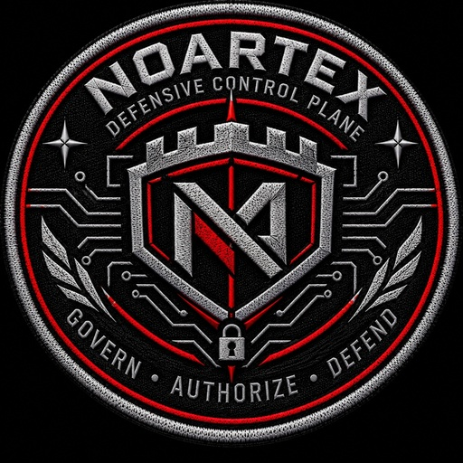
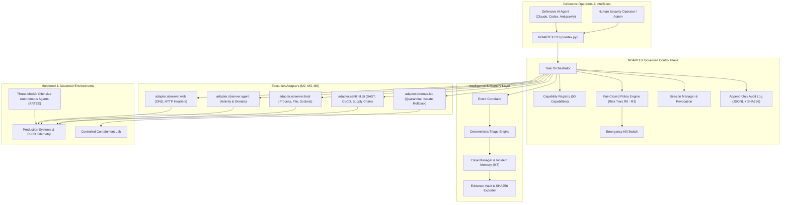
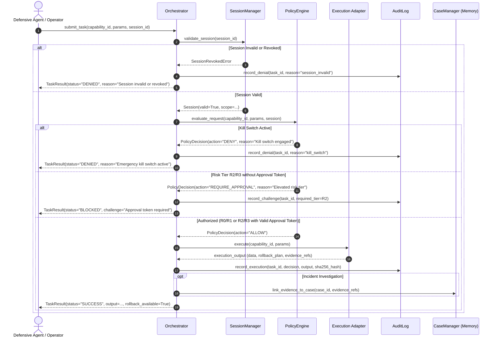
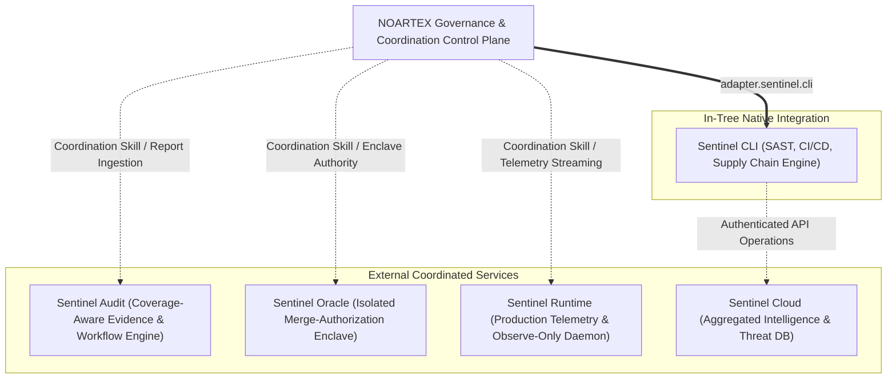

# NOARTEX



Defensive coordination and capability governance infrastructure for AI agents operating against autonomous adversarial threats.

Release: `v0.9.2` (Complete Defensive Skills Library + Real-Time Reactive Defense)  
Acceptance status: 125/125 tests passed (220/220 verification checks across milestones M1 through M9).  
Ecosystem: Coordinates with Sentinel CLI, Sentinel Audit, Sentinel Oracle, and Sentinel Runtime.



## Why NOARTEX exists

Adversaries and cybercriminals are actively weaponizing autonomous offensive AI agents (such as ARTEX and automated agentic attack frameworks) to execute multi-stage attacks against production infrastructure at machine speed. These offensive agents autonomously discover attack surfaces, exploit software vulnerabilities, escalate privileges, poison CI/CD pipelines, pivot laterally across environments, and exfiltrate or manipulate critical data without requiring continuous manual direction.

Traditional security paradigms fail against machine-speed adversarial agents:
1. **Manual SOC and incident response workflows** are orders of magnitude too slow to interrupt autonomous attack loops before lateral expansion or damage occurs.
2. **Unconstrained defensive AI bots** running ad-hoc shell commands or raw scripts introduce unacceptable operational risk into production: they lack authorization boundaries, can hallucinate destructive remediations, cause self-inflicted outages, or be hijacked via prompt injection.
3. **Disjointed security tooling** produces isolated alerts without cross-domain event correlation, unified provenance, or reversible containment guarantees.

NOARTEX provides the defensive coordination control plane and capability governance infrastructure required to counter autonomous offensive threats in production and staging environments.

Core architecture principle: **The defensive agent reasons; NOARTEX provides capabilities, enforces boundaries, and governs execution.**

NOARTEX converts agent intentions into structured, policy-mediated, and auditable transactions:
```
TaskRequest -> Session Validation -> Policy Evaluation -> Mediated Adapter Execution -> Audit Log -> TaskResult
```

This guarantees that:
- Every action is strictly authorized against a fail-closed policy matrix before execution.
- High-risk operations (risk tiers R2 and R3) require explicit, short-lived, single-use administrative approval tokens.
- An emergency kill-switch immediately disables execution of sensitive operational capabilities.
- All telemetry, decisions, and artifacts are permanently recorded in an append-only audit trail with SHA256 integrity proofs.
- Containment actions are accompanied by rollback plans to prevent unrecoverable production disruptions.

## Governed task execution lifecycle

The following sequence details how NOARTEX intercepts, evaluates, executes, and audits every operation requested by an agent or operator:



## Threat response and containment lifecycle

When countering autonomous threats like ARTEX, NOARTEX executes a closed-loop investigation and containment sequence:

```mermaid
flowchart LR
    subgraph Stage1 ["1. Telemetry & Observation"]
        direction TB
        S1["Observer Adapters"]
        S1A["Host Sockets & Processes"]
        S1B["Agent Audit Activity"]
        S1C["Network & DNS Traffic"]
        S1 --> S1A & S1B & S1C
    end

    subgraph Stage2 ["2. Correlation & Triage"]
        direction TB
        S2["Intelligence Engine"]
        S2A["Event Temporal Correlation"]
        S2B["Deterministic Triage Engine"]
        S2C{"Verdict"}
        S2 --> S2A --> S2B --> S2C
    end

    subgraph Stage3 ["3. Governed Containment"]
        direction TB
        S3["Defense Adapter"]
        S3A["Lab / Host Isolation"]
        S3B["Artifact Quarantine"]
        S3C["Generate Rollback Plan"]
        S3 --> S3A & S3B & S3C
    end

    subgraph Stage4 ["4. Memory & Evidence"]
        direction TB
        S4["Case Management"]
        S4A["Evidence Vault (SHA256)"]
        S4B["Actionable Follow-ups"]
        S4C["Incident Export Dossier"]
        S4 --> S4A & S4B & S4C
    end

    Stage1 ==> Stage2
    S2C ==>|"CONFIRMED / PARTIAL"| Stage3
    Stage3 ==> Stage4
    Stage3 -.->|"Verification Failed"| Rollback["Rollback to Prior State"]
```



## What NOARTEX is (and is not)

**What NOARTEX is:**
- A defensive coordination and capability governance control plane engineered to protect systems against autonomous offensive agents and machine-speed threats.
- A fail-closed runtime that enforces strict authorization boundaries, risk tiers (R0 through R3), session validation, and emergency kill-switches.
- A deterministic multi-source telemetry correlator and triage engine producing reproducible verdicts (`CONFIRMED`, `PARTIAL`, `UNKNOWN`, `FALSE_POSITIVE`).
- A mediated execution framework providing verifiable containment actions (quarantine, isolation, tagging) backed by pre-computed rollback plans.
- A persistent security case manager with cryptographic evidence linking (SHA256) and portable audit dossiers.
- An extensible adapter architecture that integrates external security systems (Sentinel CLI, Sentinel Audit, Sentinel Oracle, Sentinel Runtime, host/web observers).

**What NOARTEX is not:**
- Not an unconstrained autonomous bot: NOARTEX does not generate hallucinations, execute unvetted shell commands, or self-authorize actions.
- Not a replacement for human security governance: High-impact remediations require human administrative approval tokens.
- Not an opaque heuristic black-box: All policy decisions, triage paths, and execution logs are transparent, structured, and auditable.
- Not Sentinel Cloud: NOARTEX does not embed proprietary cloud backend infrastructure; cloud interactions remain external.

## Operational boundaries and risk tiers

Every capability in NOARTEX is assigned a deterministic Risk Tier:

| Risk Tier | Definition | Examples | Governance Constraint |
|---|---|---|---|
| `R0` | Read-only observation and introspection | `core.doctor.health`, `core.capabilities.list`, `observer.host.processes` | Allowed within active session |
| `R1` | Low-impact operational state adjustments | `memory.case.create`, `memory.note.add`, `sentinel.report.generate` | Allowed within scoped session permissions |
| `R2` | Reversible containment and state modifications | `defense.artifact.quarantine`, `defense.action.rollback`, `defense.artifact.tag` | Requires explicit administrative approval token or elevated session |
| `R3` | Critical administrative and high-impact operations | `policy.killswitch.activate`, `defense.host.remediate`, `policy.session.revoke` | Strict administrative policy, human approval token, immediate audit escalation |

## Verified implementation status (Milestones M1–M8)

The current release (`v0.8.0-m8`) has been comprehensively verified across all 8 architectural milestones. All 70 acceptance tests (165 individual validation checks) pass cleanly with zero regressions:

| Milestone | Subsystem | Verification Scope | Status | Acceptance Checks |
|---|---|---|---|---|
| `M1` | Core & CLI | Contracts, discovery, session management, JSONL audit logging, CLI commands | PASS | 11/11 tests pass |
| `M2` | Adapter Framework | Abstract base adapter, lifecycle health checks, Sentinel CLI bridge, doctor aggregation | PASS | 10/10 tests pass |
| `M3` | Observers | Host telemetry (processes/files/sockets), agent activity observer, web header/DNS inspector | PASS | 15/15 tests pass |
| `M4` | Intelligence | Temporal event correlation, deterministic triage engine, JSON schema verdict validation | PASS | 6/6 tests pass |
| `M5` | Permissions | Fail-closed policy evaluation, risk tiers (R0-R3), time-bound approval tokens, emergency kill-switch | PASS | 7/7 tests pass |
| `M6` | Defense Lab | Controlled artifact quarantine, tagging, isolation, automated rollback plan generation | PASS | 6/6 tests pass |
| `M7` | Memory & Cases | Incident case management, SHA256 evidence integrity, follow-up tracking, case dossier export | PASS | 5/5 tests (59/59 checks) pass |
| `M8` | End-to-End | Full incident lifecycle: detection, triage, policy gating, containment, rollback, and memory | PASS | 10/10 tests (51/51 checks) pass |
| `M9` | Real-Time Reactive Defense | Kernel eBPF streaming (Tetragon), priority event bus, auto-responder, sub-250ms end-to-end containment | PASS | 55/55 checks across 3 acceptance suites pass |
| **Total** | **Full Platform** | **9 Milestones / 51 Capabilities / 6 Execution Adapters** | **PASS** | **125/125 tests (220/220 checks)** |

## Capability surface (51 capabilities)

NOARTEX exposes 51 capabilities across 7 operational domains:

| Domain | Total | Capabilities |
|---|---:|---|
| `core` | 10 | `core.doctor.health`, `core.capabilities.list`, `core.session.create`, `core.session.validate`, `core.session.revoke`, `core.task.submit`, `core.task.get`, `core.task.cancel`, `core.audit.query`, `core.audit.export` |
| `intelligence` | 6 | `intelligence.correlate`, `intelligence.incident.create`, `intelligence.incident.update`, `intelligence.incident.get`, `intelligence.triage.evaluate`, `intelligence.report.summary` |
| `policy` | 7 | `policy.status`, `policy.evaluate`, `policy.approval.request`, `policy.approval.grant`, `policy.killswitch.activate`, `policy.killswitch.deactivate`, `policy.session.revoke` |
| `observer` | 8 | `observer.host.processes`, `observer.host.files`, `observer.host.sockets`, `observer.agent.activity`, `observer.agent.denials`, `observer.web.headers`, `observer.web.dns`, `observer.tetragon.stream` |
| `sentinel` | 4 | `sentinel.sast.scan`, `sentinel.cicd.audit`, `sentinel.supply_chain.audit`, `sentinel.report.generate` |
| `defense` | 5 | `defense.artifact.quarantine`, `defense.artifact.tag`, `defense.host.isolate`, `defense.host.remediate`, `defense.action.rollback` |
| `memory` | 11 | `memory.case.create`, `memory.case.get`, `memory.case.update`, `memory.case.close`, `memory.note.add`, `memory.evidence.add`, `memory.followup.add`, `memory.followup.update`, `memory.export`, `memory.retention.apply`, `memory.retention.status` |

## Execution adapters

| Adapter ID | Status | Capabilities Provided | Operational Scope |
|---|---|---|---|
| `adapter.sentinel.cli` | AVAILABLE | Sentinel SAST, CI/CD audit, supply chain scanning, report generation | Dispatches to local `sentinel` binary via mediated subprocess execution |
| `adapter.observer.host` | AVAILABLE | Process snapshots, file integrity queries, listening socket telemetry | Read-only local host inspection |
| `adapter.observer.agent` | AVAILABLE | Agent task execution tracking, policy denial logging | Audit log inspection of observed agent activities |
| `adapter.observer.web` | AVAILABLE | Remote HTTP response header validation, DNS record verification | Network inspection without active payload injection |
| `adapter.defense.lab` | AVAILABLE | File quarantine, permission tagging, simulated isolation, automated rollback | Controlled containment environment with state restoration |
| `adapter.observer.tetragon.stream` | AVAILABLE | Real-time eBPF stream ingestion, sensitive kprobe filtering, socket tracking | Continuous kernel-level telemetry consumption via streaming tail |

## Real-time response benchmarks (M9 verified)

Real wall-clock measurements during Operation Ghostpipe end-to-end evaluation:

| Pipeline Stage | Implementation | Measured Latency | Boundary Target |
|---|---|---:|---:|
| Priority Bus Dispatch | `core.reactive.ReactiveEventBus` | 1.88 ms | < 50 ms |
| Kernel Stream Detection | `adapters.tetragon_stream.TetragonStreamAdapter` | 17.09 ms | < 100 ms |
| Autonomous Multi-Source Correlation | `core.intelligence.EventCorrelator` | 0.79 ms | < 20 ms |
| Deterministic Triage Engine | `core.intelligence.TriageEngine` | 18.49 ms | < 50 ms |
| Policy ABAC/RBAC Evaluation | `core.policy.PolicyEngine` (AUTOMATIC mode) | 0.20 ms | < 10 ms |
| Containment Quarantine & Rollback Plan | `adapters.defense_lab.DefenseLabAdapter` | 15.20 ms | < 50 ms |
| **Total End-to-End Threat Response Loop** | **Closed Autonomous Loop** | **234.95 ms** | **< 500 ms** |

## Sentinel natural stack coordination

NOARTEX coordinates with the broader Sentinel defensive ecosystem:



| Component | Repository | Coordination Pattern |
|---|---|---|
| Sentinel CLI | `https://github.com/javier20dev25/sentinel-cli` | Native in-tree adapter (`adapter.sentinel.cli`) |
| Sentinel Audit | `https://github.com/javier20dev25/sentinel-audit` | External coordination via skill (`skills/coordination/sentinel-audit`) |
| Sentinel Oracle | `https://github.com/javier20dev25/sentinel-oracle` | External coordination via skill (`skills/coordination/sentinel-oracle`) |
| Sentinel Runtime | `https://github.com/javier20dev25/sentinel-runtime` | External coordination via skill (`skills/coordination/sentinel-runtime`) |
| Sentinel Cloud | Hosted Service | External; leveraged via authenticated Sentinel CLI operations |

## Installation and setup

### Prerequisites
- Python 3.10+
- Git 2.30+
- Sentinel CLI (optional, required for `adapter.sentinel.cli`)

### Clone with submodules
```bash
git clone --recurse-submodules https://github.com/javier20dev25/NOARTEX.git
cd NOARTEX
```

If previously cloned without submodules:
```bash
git submodule update --init --recursive
```

Bootstrap scripts are available for automated submodule setup:
```powershell
powershell -ExecutionPolicy Bypass -File scripts/bootstrap-stack.ps1
```
```bash
bash scripts/bootstrap-stack.sh
```

### Health check and verification
Validate that the control plane and adapters are operational:
```bash
python noartex.py doctor --format json
python noartex.py capabilities --format json
```

Run the complete test suite:
```bash
pytest tests/acceptance/m1/ tests/acceptance/m2/ tests/acceptance/m3/ tests/acceptance/m4/ tests/acceptance/m5/ tests/acceptance/m6/ tests/acceptance/m7/ tests/acceptance/m8/ -v
```

## Skills library

NOARTEX ships a library of 12 general-purpose security skills submitted as governed tasks through the M4 intelligence pipeline and M6 defense lab. All skills are vendor-neutral, fail-closed by default, and independently implemented from open-source reference architectures.

### Static audit and supply chain

| Skill | Risk tier | Description |
|---|---|---|
| `structured-audit` | R2 | Six-phase structured security audit: reconnaissance, coverage mapping, vulnerability hunting, independent validation, structured findings, evidence verification. |
| `agent-config-audit` | R1 | Static audit of agent instruction files, MCP server registrations, hook definitions, and permission manifests for secrets, excessive grants, and injection risk. |
| `egress-audit` | R2 | Analysis of outbound network access patterns, exfiltration paths, egress control infrastructure gaps, and minimum required egress specification. |
| `skill-inspection` | R2 | Vetting of third-party skills before registration: prompt injection detection, privilege escalation, exfiltration indicators, supply-chain risk. Produces APPROVE / CONDITIONAL / REJECT decision. |
| `false-positive-review` | R1 | Structured workflow for validating or dismissing candidate findings with rationalization rejection rules and mandatory independent re-validation. |
| `supply-chain-evaluation` | R2 | Lockfile integrity, package provenance, maintainer trust indicators, known-vulnerability cross-reference, and runtime fetch risk assessment. |
| `process-isolation-audit` | R2 | Gap analysis of OS-level sandbox controls (filesystem, network, capabilities, resource limits) for agent-spawned processes against a least-privilege baseline. |

### Real-time defense and autonomous operations

| Skill | Risk tier | Description |
|---|---|---|
| `threat-hunt` | R2 | Hypothesis-driven threat hunting across endpoint telemetry, process lineages, socket activity, and memory artifacts. Separates sensor, adversary, and third-party evidence. |
| `observable-enrichment` | R1 | Deep observable investigation and multi-source enrichment for IP addresses, domains, file hashes, and URLs. Implements structured analyzer contracts; never assumes unlisted items are benign. |
| `active-response` | R3 | Governed real-time active defense response execution: process suspension, socket severance, IP blocking, token revocation, quarantine with pre-computed rollback plans and auto-reversion. |
| `investigation-ledger` | R1 | Cryptographically verifiable investigation ledger for active security incidents. Records tool invocations, evidentiary citations, analyst hypotheses, and groundedness metrics. |
| `runtime-anomaly-detection` | R2 | Continuous runtime behavioral anomaly detection evaluating streaming syscalls (execve, openat2, connect) against declarative behavioral security invariants. |

Skills are located under `skills/<skill-name>/SKILL.md`. Each skill declares its risk tier and routes through the NOARTEX policy engine -- they add analytical knowledge but never bypass governance.

Reference sources (concepts studied; code independently re-implemented under Apache-2.0):
- Static Audit & Vetting: Cloudflare security-audit-skill (MIT), AgentShield (MIT), Pipelock (Apache-2.0), NVIDIA SkillSpector (Apache-2.0), Cisco AI Defense Skill Scanner (Apache-2.0), Anthropic Sandbox Runtime (Apache-2.0), Trail of Bits skills (CC BY-SA 4.0 -- concepts studied, re-implemented independently).
- Real-Time Defense & Autonomous SOC: Vigil SOC (Apache-2.0, autonomous specialists and evidence provenance), AiSOC (MIT, investigation ledger and groundedness verification), Wazuh (GPL-2.0, active response and rollback leases), TheHive & Cortex Analyzers (AGPL-3.0/GPL-3.0, observable enrichment contracts), Falco & Tetragon (Apache-2.0, runtime behavioral invariants and eBPF stream telemetry).

## Repository structure

```
NOARTEX/
├── noartex.py                          # Unified CLI entrypoint wrapper
├── cli/                                # CLI command parsing and handlers
├── core/                               # Governed control plane
│   ├── contracts/                      # Type definitions, interfaces, data classes
│   ├── orchestrator.py                 # Task dispatch and execution pipeline
│   ├── discovery/                      # Capability registration and schemas
│   ├── policy/                         # Fail-closed policy engine and risk tiers
│   ├── session/                        # Session lifecycle and revocation
│   ├── audit/                          # Append-only JSONL audit logger
│   ├── intelligence/                   # Correlation and deterministic triage
│   ├── memory/                         # Case management, evidence, and follow-ups
│   └── adapters/base.py                # Base execution adapter interface
├── adapters/                           # Concrete execution adapters
│   ├── sentinel_adapter.py             # Sentinel CLI integration
│   ├── host_observer.py                # Host process/file/socket observer
│   ├── agent_observer.py               # Agent activity observer
│   ├── web_observer.py                 # Network DNS/HTTP observer
│   ├── defense_lab.py                  # Quarantine, isolation, and rollback
│   └── tetragon_stream.py              # Real-time eBPF kernel stream adapter
├── skills/                             # Agent operational skills
│   ├── canonical/SKILL.md              # NOARTEX canonical agent skill
│   ├── coordination/                   # Ecosystem coordination skills
│   ├── structured-audit/               # Six-phase structured security audit (R2)
│   ├── agent-config-audit/             # Agent configuration static audit (R1)
│   ├── egress-audit/                   # Outbound network access analysis (R2)
│   ├── skill-inspection/               # Third-party skill vetting (R2)
│   ├── false-positive-review/          # Finding validation and disposition (R1)
│   ├── supply-chain-evaluation/        # Package and dependency integrity (R2)
│   ├── process-isolation-audit/        # OS-level sandbox gap analysis (R2)
│   ├── threat-hunt/                    # Hypothesis-driven telemetry threat hunting (R2)
│   ├── observable-enrichment/          # Multi-source observable investigation (R1)
│   ├── active-response/                # Reversible automated containment actions (R3)
│   ├── investigation-ledger/           # Cryptographic evidence & groundedness ledger (R1)
│   └── runtime-anomaly-detection/      # eBPF/syscall behavioral invariant matching (R2)
├── stack/                              # Git submodules for natural stack
├── tests/                              # Acceptance test suites (M1 through M9)
└── docs/                               # Architecture graphs, specs, and evidence
```

## Security and governance guarantees

1. **Fail-Closed Authorization:** Every capability invocation is denied by default unless an active session possesses matching permissions and satisfies risk-tier constraints.
2. **Deterministic Triage:** Intelligence evaluation relies on explicit, reproducible evidentiary inputs, avoiding heuristic speculation.
3. **Verified Reversibility:** Containment actions generate an immutable rollback plan before state modification occurs.
4. **Cryptographic Evidence Tracking:** All case evidence, notes, and task results are linked via SHA256 hashes for non-repudiation.
5. **No Blind Remediation:** Unavailable or degraded adapter states are explicitly flagged; missing evidence is never reported as clean or resolved.

## Continuous improvement and community collaboration

NOARTEX is actively developed as an open defensive capability plane to counter machine-speed autonomous malware threats (ARTEX class). We invite security researchers, systems programmers, and AI safety engineers to collaborate on the continuous improvement of the platform:

- **Adapter Expansion:** Implementing telemetry integrations for Falco, OSQuery, Auditd, Cilium, and Windows Event Tracing (ETW).
- **Policy Engine Hardening:** Formalizing capability lattice rules, mitigating adversarial multi-step capability chaining, and stress-testing R0-R3 boundaries.
- **Runtime Performance:** Optimizing eBPF stream filtering latency, shared ring buffers, and event bus preemption under heavy load.
- **Empirical Red Team Evaluation:** Benchmarking novel autonomous evasion and lateral movement vectors in hermetic defense lab environments.

See [CONTRIBUTING.md](CONTRIBUTING.md) for full development guidelines, coding tenets, and contribution procedures.

## Pull requests, issues, and vulnerability reporting

- **Pull Requests:** Must adhere to conventional commit naming (`feat:`, `fix:`, `perf:`, `test:`, `docs:`), preserve fail-closed semantics, include zero emojis/marketing hype, and pass all acceptance suites (M1–M9) in CI without regressions.
- **Public Issues:** Reserved for reproducible bugs, feature proposals (RFCs), and documentation updates. Follow the issue templates under `.github/ISSUE_TEMPLATE/`.
- **Security Vulnerabilities (Private Disclosure):** Do NOT file public issues or pull requests for vulnerabilities, zero-days, or policy bypasses. Report security issues directly to the maintainer's personal email:
  - **Personal Security Contact:** `sleytherjavier2025@gmail.com`
  - **Alternative Channel:** Repository [GitHub Security Advisories](https://github.com/javier20dev25/NOARTEX/security/advisories)
  - Detailed reporting instructions, SLA, and disclosure timelines are documented in [SECURITY.md](SECURITY.md).

## License

This project is licensed under the Business Source License 1.1 (BUSL-1.1). See [LICENSE](LICENSE) for terms.
