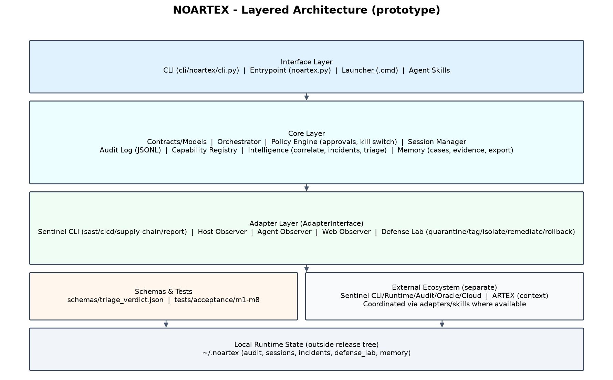
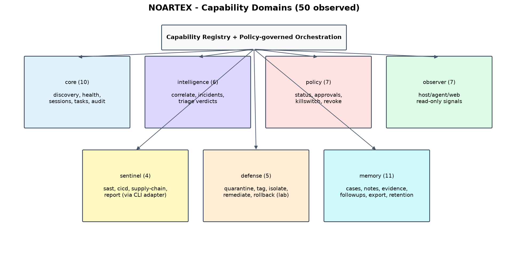
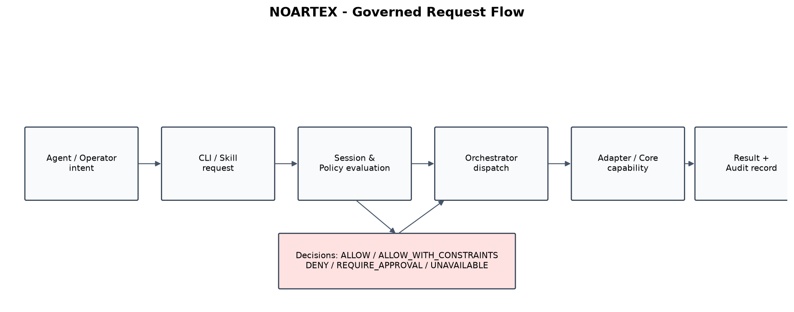
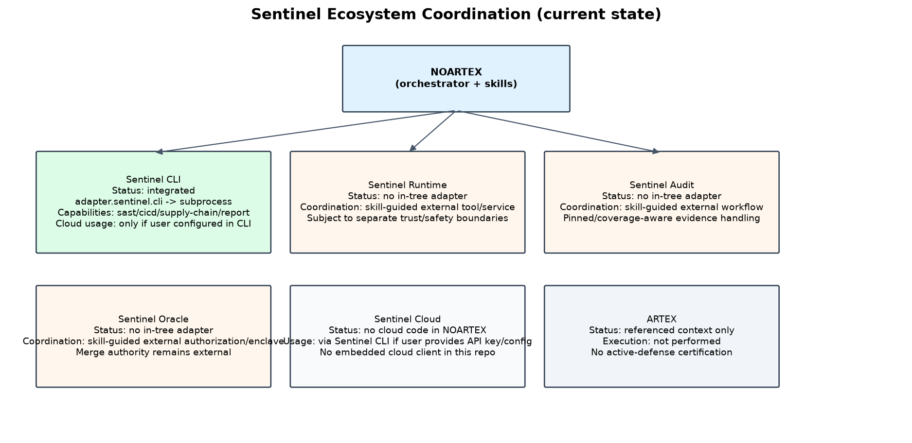

# NOARTEX

Declarative release target: `v0.8.0-m8` (prototype, lab-validated scope).  
Observed runtime identity in current tree: CLI reports `0.6.0-m6`, `doctor` reports `core 1.0.0-m1`, capability/contract records report `1.0.0`/`1.0`.  
Status: **built and operable as a prototype; release identity not yet frozen; not production-certified**.



## Why NOARTEX exists

Modern AI coding agents can reason, plan, and generate changes, but they do not by themselves provide a governed defensive control plane: capability discovery, authorization boundaries, mediated execution, evidence capture, incident correlation, and reversible lab actions. NOARTEX exists to provide that infrastructure so an external agent can act as a **defensive operator** inside explicit limits.

Core principle: **the agent thinks; NOARTEX provides capabilities and governs execution.**

NOARTEX is designed to turn agent intent into structured, auditable tasks (`TaskRequest -> PolicyDecision -> TaskResult`) instead of ad-hoc shell activity. This matters for security work where uncertainty, provenance, scope, and reversibility must be explicit.

## What NOARTEX is (and is not)

**Is**
- A coordination and capability infrastructure for AI agents in defensive/security workflows.
- A policy-mediated runtime with sessions, audit logging, capability registry, intelligence/triage, memory/cases, observers, and lab-defense adapters.
- A prototype that can integrate external security tools through adapters and guide coordination through skills.

**Is not**
- Not an autonomous AI agent, SOC analyst replacement, or unrestricted remediation engine.
- Not a production-certified EDR/SOAR/XDR, and not certified for active defense against ARTEX.
- Not Sentinel Cloud, and not a cloud backend embedded in this repository.
- Not proof of compromise/cleanliness when evidence is missing; unavailable/degraded coverage must remain explicit.

## Responsibilities and boundaries

| Responsibility | NOARTEX role | Outside / boundary |
|---|---|---|
| Agent reasoning and intent | External agent (Codex/Claude/OpenCode/etc.) | NOARTEX does not think or self-authorize |
| Capability discovery and contracts | Registry, contracts, schemas | Tool-specific correctness depends on adapters/tools |
| Authorization and governance | Policy engine, approvals, kill switch, session checks | Human/org authorization policy remains external |
| Execution mediation | Orchestrator dispatch to core handlers/adapters | No direct privileged action by the agent bypassing NOARTEX |
| Evidence and auditability | JSONL audit log, task/decision/result records, case export hashes | Local append-only evidence is not full external cryptographic anchoring |
| Defensive actions | Lab-scoped defense adapter (quarantine/tag/isolate/remediate/rollback) | No certified production host isolation/remediation/revocation |
| External tool/service operation | Invoke/coordinate when integrated or instructed | Sentinel Runtime/Audit/Oracle/Cloud remain separate systems with their own trust boundaries |

## Current implementation status (evidence-backed)

| Dimension | Status | Notes |
|---|---|---|
| Prototype implemented (M1-M8 scope) | Verified in observed runtime/tree | Core, adapters, memory, defense lab, intelligence, policy components present |
| Runtime operability | Verified (observed) | `doctor` reports operational core/policy/session/audit/registry; adapter health may vary at runtime |
| Capability surface | Verified (observed) | 50 capabilities exposed, 7 domains: core, intelligence, policy, observer, sentinel, defense, memory |
| Adapter registrations | Verified (observed) | 5 adapters: `adapter.sentinel.cli`, `adapter.observer.host`, `adapter.observer.agent`, `adapter.observer.web`, `adapter.defense.lab` |
| M7/M8 integration in runtime | Verified in catalog/runtime | `memory.*`, `policy.approval/killswitch/session.*`, `defense.*` exposed |
| Acceptance evidence | Partially verified | Preserved M8 `51/51` log evidence exists; aggregate M1-M8 totals reported but not fully rebound to a frozen release manifest in this tree |
| Release identity `v0.8.0-m8` | Not frozen | Version labels differ across CLI/core/contracts/docs; no Git tag/manifest in current working tree state |
| Production / active defense readiness | Not certified | Lab/synthetic validation only; hardening and operational certification pending |

See `NOARTEX_RELEASE_RECONCILIATION_v0.8.0-m8.md` and `docs/TOOLS_AND_REVERSE_ENGINEERING.md`.

## Architecture

- Machine-readable graph for agents: `docs/architecture_graph.json`
- Generator: `docs/generate_architecture_graph.py`
- Visual maps:







### Component map (summary)


## Capabilities and adapters

### Capability domains (50 observed)

| Domain | Count | Examples |
|---|---:|---|
| `core` | 10 | `core.doctor.health`, `core.capabilities.list`, `core.session.*`, `core.task.*`, `core.audit.query` |
| `intelligence` | 6 | `intelligence.correlate`, `intelligence.incident.*`, `intelligence.triage.evaluate` |
| `policy` | 7 | `policy.status`, `policy.approval.*`, `policy.killswitch.*`, `policy.session.revoke` |
| `observer` | 7 | `observer.host.*`, `observer.agent.*`, `observer.web.*` |
| `sentinel` | 4 | `sentinel.sast.scan`, `sentinel.cicd.audit`, `sentinel.supply_chain.audit`, `sentinel.report.generate` |
| `defense` | 5 | `defense.artifact.*`, `defense.host.isolate/remediate`, `defense.action.rollback` |
| `memory` | 11 | `memory.case.*`, `memory.note/evidence/followup.*`, `memory.export`, `memory.retention` |

### Adapters in this tree

| Adapter | Status (designed/observed) | Provides | Notes |
|---|---|---|---|
| `adapter.sentinel.cli` | Implemented, runtime-observed AVAILABLE/DEGRADED depending on CLI health | Sentinel SAST/CI-CD/supply-chain/report operations | Invokes local `sentinel` binary via subprocess; no Sentinel Cloud client embedded in NOARTEX |
| `adapter.observer.host` | Implemented, observed AVAILABLE | Host process/file/network snapshots | Read-only, snapshot/inspection oriented |
| `adapter.observer.agent` | Implemented, observed AVAILABLE | Agent activity/denial observations from audit data | Scoped to NOARTEX-observed activity |
| `adapter.observer.web` | Implemented, observed AVAILABLE | HTTP header/DNS observations | Targeted checks, not full traffic inspection |
| `adapter.defense.lab` | Implemented, observed AVAILABLE | Lab quarantine/tag/isolate/remediate/rollback capabilities | Lab/sandbox scoped; not production-certified remediation |

## Sentinel ecosystem coordination

NOARTEX can **coordinate** external Sentinel tools according to what is integrated and what the agent/operator is authorized to do:

| Component | NOARTEX coordination status | How |
|---|---|---|
| Sentinel CLI | Native adapter integration present | `adapter.sentinel.cli` dispatches governed tasks to local Sentinel CLI |
| Sentinel Runtime | No in-tree adapter currently | Coordination by skill/runbook and external operator workflows (separate service/tool, separate boundaries) |
| Sentinel Audit | No in-tree adapter currently | Coordination by skill/runbook and external execution/report ingestion workflows |
| Sentinel Oracle | No in-tree adapter currently | Coordination by skill/runbook; merge authorization remains external enclave authority |
| Sentinel Cloud | No cloud code in NOARTEX | Usage guidance only; if a user has Sentinel CLI configured with a Sentinel Cloud API key, Cloud-backed CLI commands may be used by Sentinel CLI (outside NOARTEX codebase) |

**Important:** This repository does not include Sentinel Cloud backend/client implementation code. It includes skills/documentation for governed usage patterns.

## Skills

| Skill | Location | Purpose |
|---|---|---|
| Canonical NOARTEX skill | `skills/canonical/SKILL.md` | Primary skill for using NOARTEX capabilities and governance model |
| Sentinel Runtime coordination | `skills/coordination/sentinel-runtime/SKILL.md` | Guide agents to coordinate with external Sentinel Runtime safely |
| Sentinel Audit coordination | `skills/coordination/sentinel-audit/SKILL.md` | Guide agents to coordinate with external Sentinel Audit workflows |
| Sentinel Oracle coordination | `skills/coordination/sentinel-oracle/SKILL.md` | Guide agents to coordinate with external Sentinel Oracle decisions/enclave |
| Sentinel Cloud usage (via CLI) | `skills/coordination/sentinel-cloud-usage/SKILL.md` | Governed usage guidance when Sentinel CLI has user-provided Cloud credentials/config |

Portable skill copies may exist outside this repository (for agent environments) and should be kept version-aligned when releases are frozen.

## ARTEX

ARTEX is treated as **adversarial/context reference**, not as an executed target in this repository state. NOARTEX is not certified for active defense against ARTEX. Any claims about stopping, containing, or safely responding to ARTEX require separate evidence, authorization, and hardening beyond this prototype.

## Reverse-engineered tool integrations and provenance

See `docs/TOOLS_AND_REVERSE_ENGINEERING.md` for:
- Enumerated tools/components and how they are integrated (adapter, CLI subprocess, schema/contract alignment, skill-guided coordination)
- Evidence basis (local inspected projects/manifests/docs and NOARTEX adapter behavior)
- What is confirmed vs inferred vs unknown
- Explicit statement that Sentinel Cloud code is not vendored/embedded in NOARTEX

## Repository layout (current)

- `noartex.py`: Python entry wrapper
- `cli/noartex/cli.py`: CLI implementation and command surface
- `core/`: contracts, orchestrator, discovery, policy, session, audit, intelligence, memory, adapter base
- `adapters/`: sentinel CLI, host/agent/web observers, defense lab
- `schemas/`: JSON schemas (e.g. triage verdict)
- `skills/`: canonical and coordination skills
- `tests/acceptance/m1-m8/`: acceptance suites
- `docs/`: architecture graph, images, inventories, coordination notes

Local/dev artifacts such as `data/test_*` and generated caches are excluded from version control by `.gitignore`.

## Usage (local prototype)

```bash
python noartex.py doctor --format json
python noartex.py capabilities --format json
python noartex.py --help
```

If using the Windows launcher in your environment, verify it resolves to the same tree and version:

```powershell
& "C:\Users\sleyt\.gemini\antigravity\bin\noartex.cmd" --version
```

## Security and evidence model

- Policy decisions are external to the agent (allow/deny/require approval/constraints/unavailable).
- Audit records and task results are first-class outputs; degraded/unavailable states must not be reported as clean.
- Defense capabilities in this prototype are lab-oriented and reversible by design intent, but not production-certified.
- No guarantee of complete detection, attribution, containment, or remediation.

## License

`LICENSE` is present as a **BUSL-1.1 intent/template** aligned with related Sentinel ecosystem components, but key parameters (licensor, year, additional use grant, change date, change license) are marked **PENDING** and must be finalized by the rights holder before this is treated as a finalized grant. No finalized commercial or production permission is implied by the draft. Review terms before redistribution or production/commercial use.

## Related documents

- `NOARTEX_PRODUCT_ARCHITECTURE_AND_ACCEPTANCE_SPEC_001.md`
- `NOARTEX_RELEASE_RECONCILIATION_v0.8.0-m8.md`
- `NOARTEX_PHASE_4T_FINAL_CLOSEOUT.md` (separate track, closed reconciliation; remediation open)
