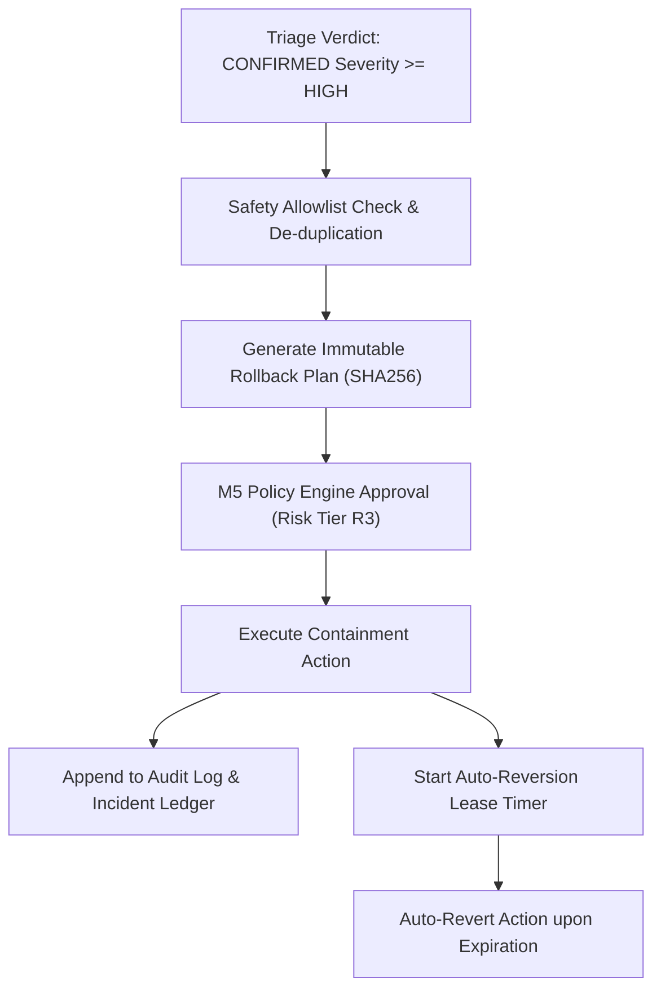

# Active Response Skill

## Purpose

Execute decisive, machine-speed defensive containment actions against active
adversarial threats (such as ARTEX-class malicious agents) while guaranteeing
complete reversibility, blast-radius containment, and operational continuity.

Adapted from architectural patterns in Wazuh Active Response (GPL-2.0 concepts
re-implemented independently under Apache-2.0) and Shuffle SOAR workflows,
integrated directly with NOARTEX M6 Defense Lab and M5 Policy Engine.

## Core Response Guarantees

1. **Mandatory Pre-Computed Rollback Plan:**
   No containment action may execute unless an immutable, machine-executable
   rollback plan is generated and signed with a SHA256 checksum *before* the
   system state is modified.

2. **Time-Bounded Auto-Reversion (Lease Expiration):**
   Every temporary containment action (e.g., firewall block, process freeze)
   carries a strict Time-To-Live (TTL). If an operator or automated control
   plane does not explicitly renew the containment lease before TTL expiration,
   the action automatically reverts to restore baseline operations.

3. **Anti-Deadlock & Safety Allowlist Safeguards:**
   Active responses must never terminate core operating system daemons,
   NOARTEX control plane components, primary SSH/management interfaces, or
   storage cluster interconnects. Attempts to target protected infrastructure
   trigger immediate fail-closed denial.

4. **Action De-duplication:**
   Prevents concurrent or redundant response dispatches targeting the same
   process tree, IP address, or credential set.

## Supported Action Classes

### A1 -- Process Freezing & Termination (SIGSTOP / SIGTERM)
- Targets adversary agent interpreters, malicious child shells, and unauthorized
  background workers.
- First step: Send `SIGSTOP` to suspend execution, preserving memory artifacts
  for live triage.
- Escalation: Send `SIGTERM` / `SIGKILL` only if memory capture is complete or
  immediate harm is imminent.

### A2 -- Network Isolation & Socket Severance
- Terminates specific active TCP/UDP connections without bringing down the
  entire network interface.
- Applies localized host firewall rules (nftables/iptables drop rule) on the
  specific remote 5-tuple or IP address.
- Configures temporary loopback redirect for DNS sinks.

### A3 -- Credential & Session Revocation
- Invalidates active agent API tokens, session cookies, and temporary credentials
  identified in compromised execution paths.
- Tags compromised service principals as `RESTRICTED_DEFENSIVE_HOLD`.

### A4 -- File Artifact Quarantine
- Atomically moves suspicious binaries, dropped scripts, or poisoned lockfiles
  into the hermetic defense lab quarantine directory (`/var/lib/noartex/quarantine/`).
- Strips executable permissions (`chmod 0000`) and records SHA256 checksums.

## Execution Workflow



## Output Format

```yaml
active_response_result:
  action_id: "ar-YYYYMMDD-XXXX"
  action_type: "PROCESS_FREEZE_AND_NETWORK_BLOCK"
  target:
    pid: 48921
    process: "/tmp/malicious_agent.py"
    remote_ip: "198.51.100.23"
  status: "EXECUTED"
  policy_decision: "APPROVED_R3"
  rollback_plan:
    id: "rb-YYYYMMDD-XXXX"
    sha256: "e3b0c44298fc1c149afbf4c8996fb92427ae41e4649b934ca495991b7852b855"
    executable_command: "kill -CONT 48921; nft delete rule inet filter output handle 14"
  lease_seconds: 300
  expires_at: "2026-11-20T04:35:00Z"
```

## NOARTEX Integration

```bash
noartex task submit \
  --module M6 \
  --skill active-response \
  --params '{"action": "PROCESS_FREEZE", "target_pid": 48921, "ttl_seconds": 300}' \
  --policy R3
```
